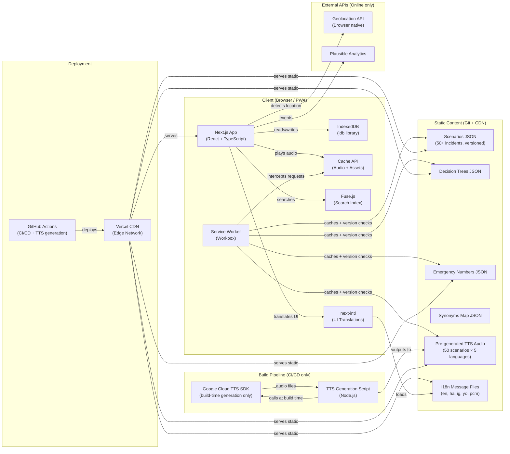
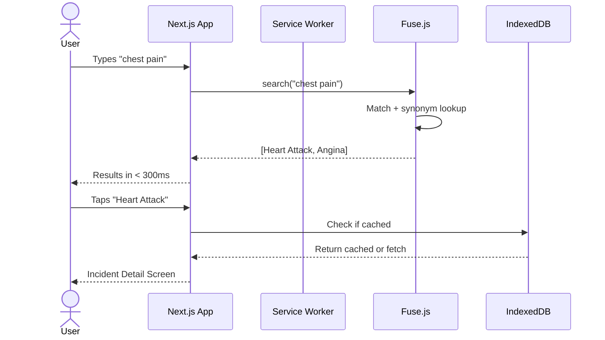
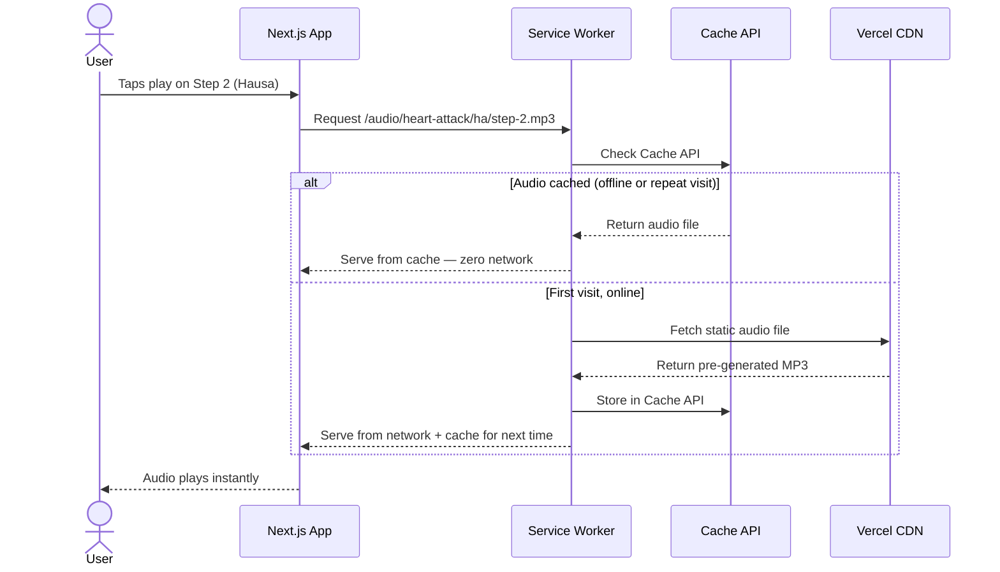

# AidHero — Product Requirements Document (PRD)
> Version 1.0 | Phase 3 PRD

---

## 1. Product Overview

### What It Is
AidHero is an offline-first Progressive Web App (PWA) that provides instant, guided first aid instructions for medical emergencies — designed specifically for Nigeria and West Africa, where emergency services are unreliable or inaccessible.

### Who It's For
| Persona | Scenario | Need |
|---|---|---|
| **The Bystander** | Witness to a street accident, cardiac event, choking | Immediate, panic-proof guidance in seconds |
| **The Caregiver** | Family member handling an injured person at home | Step-by-step instructions to stabilise before hospital |
| **The Prepared Citizen** | Parent, teacher, community leader | Knowledge of correct first aid for common scenarios |

### Why It Matters
- Nigeria has 1 doctor per 2,500 people (WHO, 2023)
- Lagos State Ambulance Service (LASAMBUS) average response time: 45+ minutes in traffic
- Most emergency deaths in Nigeria occur in the first 10 minutes from lack of bystander intervention
- No existing first aid app provides offline TTS guidance in Hausa, Igbo, Yoruba, or Pidgin English

### Tagline
> *"You can save a life. AidHero shows you how."*

---

## 2. North Star Metrics

| Metric | 6-month target | 12-month target |
|---|---|---|
| Monthly Active Users (MAU) | 50,000 | 500,000 |
| Emergency calls initiated via app | 5,000 | 50,000 |
| States reached (Nigeria) | 10 | 36 + FCT |
| Languages actively used | 5 | 5 |
| Offline sessions (% of total) | 30% | 45% |

---

## 3. Core User Stories & Acceptance Criteria

### US-01 — Bystander Emergency Search
**As a** bystander witnessing an emergency,  
**I want to** search for the incident and get instructions in under 10 seconds,  
**So that** I can act immediately without delay.

**Acceptance Criteria:**
```gherkin
Given I open AidHero on any device
When I type "heart attack" or "chest pain" or "my heart dey pain"
Then I see matching results within 300ms
And results include synonym-matched incidents
And tapping a result takes me to the incident detail in ≤ 2 taps total

Given I have no internet connection
When I search for any of the top 20 scenarios
Then I still see results and full instructions without degradation
```

---

### US-02 — Guided Rescue Flow
**As a** panicked bystander,  
**I want to** be guided through simple yes/no questions,  
**So that** I receive personalised first aid steps for the specific condition.

**Acceptance Criteria:**
```gherkin
Given I am on an incident detail page
When I tap "Start Guided Rescue"
Then I see a single question per screen
And each screen has no more than 3 options
And I can go back to the previous question at any time
And after max 3 questions I reach actionable steps
And I can skip the decision tree to quick steps at any point
```

---

### US-03 — Step-by-Step Instructions with TTS
**As a** user providing first aid with hands occupied,  
**I want** instructions read aloud in my preferred language,  
**So that** I can keep my hands on the victim while following guidance.

**Acceptance Criteria:**
```gherkin
Given I am on the step-by-step instructions screen
When I tap the play button on any step
Then TTS plays the instruction in my selected language
And the currently-spoken text is highlighted

Given I activate Voice Mode
When TTS reads a step and finishes
Then the app automatically advances to the next step
And I can say "repeat" or "next" to control navigation

Given I have no internet connection and have pre-cached audio
When I tap play on a step
Then audio plays from the local cache without any network request
```

---

### US-04 — Emergency Call
**As a** user in an emergency,  
**I want** to call the correct emergency number for my location in one tap,  
**So that** I do not waste time searching for the number.

**Acceptance Criteria:**
```gherkin
Given I open the Emergency Contacts screen
When the app detects my location as Lagos State
Then I see LASEMA (767), LASAMBUS (08000-HEALTH), and Police (199) prominently
And tapping any number shows a confirmation screen before calling
And I can manually change my state if auto-detection is wrong

Given I am on any screen in the app
Then the Emergency Call button is reachable in ≤ 2 taps from any screen
```

---

### US-05 — Language Selection & Full UI Translation
**As a** Hausa-speaking user in Kano,  
**I want** the entire app — all instructions, labels, buttons, and TTS — in Hausa,  
**So that** I can use AidHero fully in my primary language without any English dependency.

**Acceptance Criteria:**
```gherkin
Given I first open AidHero
When onboarding asks for my language
Then I can select from: English, Hausa, Igbo, Yoruba, Pidgin
And my selection persists across sessions via IndexedDB
And the entire UI — all labels, buttons, step instructions, warnings, and navigation — 
  switches to the selected language immediately
And TTS uses pre-generated audio in the selected language

Given I select Yoruba
Then the home screen title, search placeholder, category names, 
  incident titles, step instructions, do-not warnings, emergency button labels, 
  and navigation tabs all render in Yoruba
And the language is applied from IndexedDB on every subsequent visit
  without requiring re-selection

Given I want to change language mid-session
When I tap the language flag icon in the header (always visible)
Then a bottom sheet shows all 5 language options
And selecting a new language applies immediately to the current screen
And all subsequent screens use the new language
And TTS switches to the new language audio files

Given I am offline and have pre-cached audio in my selected language
When I tap play on any step
Then audio plays in my selected language from the local cache
And no network request is made

Given the app cannot detect a stored language preference
Then the app defaults to English
```

### Language Code Reference
| Language | Code | UI Label | Flag |
|---|---|---|---|
| English | en | English | 🇳🇬 |
| Hausa | ha | Hausa | 🇳🇬 |
| Igbo | ig | Igbo | 🇳🇬 |
| Yoruba | yo | Yorùbá | 🇳🇬 |
| Nigerian Pidgin | pcm | Pidgin | 🇳🇬 |

---

### US-06 — Offline Access
**As a** user in an area with poor network coverage,  
**I want** AidHero to work fully without internet,  
**So that** emergencies in low-connectivity areas are still covered.

**Acceptance Criteria:**
```gherkin
Given I have opened AidHero at least once with internet
When I open the app without internet connection
Then all top 20 scenarios load fully
And emergency numbers are accessible
And decision trees function normally
And a green "Offline Ready" badge confirms offline status

Given I navigate to a scenario I have not viewed before while offline
Then I see a message that this content needs internet to load for the first time
And I am shown the closest available cached alternative
```

---

### US-07 — Accessibility (Screen Reader)
**As a** blind user,  
**I want** to navigate AidHero using a screen reader,  
**So that** I can access emergency guidance independently.

**Acceptance Criteria:**
```gherkin
Given I have VoiceOver (iOS) or TalkBack (Android) enabled
When I open AidHero
Then all interactive elements have descriptive ARIA labels
And focus order is logical (top → bottom, left → right)
And modal dialogs trap focus correctly
And emergency call button announces "Call Lagos Emergency 767, double-tap to activate"

Given I navigate the step-by-step instructions
Then each step is announced with its number: "Step 2 of 5: Tilt the head back"
```

---

### US-08 — PWA Install + Home Screen
**As a** user who wants quick access,  
**I want** to install AidHero to my home screen,  
**So that** I can open it in one tap during an emergency.

**Acceptance Criteria:**
```gherkin
Given I visit aidhero.ng in a supported browser
When prompted or when I visit Settings
Then I see an "Add to Home Screen" or "Install App" option
And after installing, AidHero opens in standalone mode (no browser chrome)
And a widget shortcut is available on Android (linking to Search or Emergency Contacts)
```

---

## 4. Tech Stack

### Rationale
This stack prioritises: zero backend cost (free forever model), offline-first capability, and fast delivery.

| Layer | Technology | Justification |
|---|---|---|
| **Framework** | Next.js 14+ (App Router) | Best PWA support, TypeScript native, Vercel deployment |
| **Language** | TypeScript | Type safety, agent-friendly, scales with team |
| **Styling** | Tailwind CSS + CSS Variables | Design token system, fast iteration |
| **Components** | shadcn/ui | Accessible base, customisable, no lock-in |
| **PWA** | @ducanh2912/next-pwa + Workbox | Service worker, offline caching, install prompt |
| **Search** | Fuse.js | Client-side fuzzy search, works offline, tiny (< 10kb) |
| **State** | Zustand | Lightweight, no boilerplate, SSR-compatible |
| **TTS (English)** | Web Speech API | Browser-native, free, true offline |
| **TTS (Nigerian languages)** | Pre-generated static MP3 (Google Cloud TTS at build time) | Generated once in CI/CD, served as static files — zero runtime API cost |
| **TTS Generation Script** | Node.js + Google Cloud TTS SDK | Runs in CI/CD pipeline, generates all audio at build time |
| **i18n (UI translation)** | next-intl | Full UI translation for all 5 languages, static-compatible |
| **Offline Audio** | Static files in `/public/audio/` + Cache API | Served from CDN, cached by service worker — works fully offline |
| **Offline Data** | IndexedDB (via idb) | Scenario data, preferences, usage history |
| **Analytics** | Plausible Analytics | Privacy-first, self-hostable, free tier available |
| **Hosting** | Vercel (free tier) | Zero-config Next.js, global CDN, HTTPS |
| **Content** | Static JSON + MDX | No backend required, version-controlled, fast |
| **Fonts** | Google Fonts (Syne + DM Sans) | Self-hostable subset for offline |

### No Backend in V1
All data is static — no server, no database, no auth. This means:
- Zero infrastructure cost
- Zero server maintenance
- Instant global CDN delivery
- Content managed via Git (PRs for new scenarios)

---

## 5. System Architecture

### Architecture Diagram (Mermaid)



### Data Flow — Emergency Search



### Data Flow — Offline TTS (Static Audio Model)



> **Key difference from v1 design:** Google Cloud TTS is never called at runtime.
> All audio is pre-generated during CI/CD and shipped as static files on the CDN.
> No API key needed in the browser. No runtime cost. Fully offline from first cache.

---

## 6. Frontend Specification

### Directory Structure

```
aidhero/
├── app/
│   ├── layout.tsx              # Root layout, font loading, PWA meta
│   ├── page.tsx                # Home screen (S01)
│   ├── search/
│   │   └── page.tsx            # Search screen (S02)
│   ├── incidents/
│   │   ├── page.tsx            # Category browse (S03)
│   │   └── [slug]/
│   │       ├── page.tsx        # Incident detail (S04)
│   │       ├── rescue/
│   │       │   └── page.tsx    # Guided rescue flow (S05)
│   │       └── steps/
│   │           └── page.tsx    # Step-by-step (S06)
│   ├── emergency/
│   │   └── page.tsx            # Emergency contacts (S08)
│   ├── settings/
│   │   └── page.tsx            # Settings (S10)
│   └── onboarding/
│       └── page.tsx            # Onboarding (S13)
├── components/
│   ├── ui/                     # shadcn/ui base components
│   ├── emergency/
│   │   ├── EmergencyCallButton.tsx
│   │   ├── IncidentCard.tsx
│   │   └── SeverityBadge.tsx
│   ├── search/
│   │   ├── SearchBar.tsx
│   │   └── SearchResults.tsx
│   ├── rescue/
│   │   ├── DecisionQuestion.tsx
│   │   ├── StepCard.tsx
│   │   ├── ProgressIndicator.tsx
│   │   └── VoiceMode.tsx
│   ├── tts/
│   │   ├── TTSButton.tsx
│   │   └── TTSProvider.tsx
│   ├── content/
│   │   └── ContentUpdateBanner.tsx  # "Content updated" notification
│   ├── layout/
│   │   ├── BottomNav.tsx
│   │   ├── OfflineBadge.tsx
│   │   └── LanguageToggle.tsx       # Header language flag button
│   └── onboarding/
│       └── OnboardingSlide.tsx
├── i18n/
│   ├── messages/
│   │   ├── en.json             # English UI strings
│   │   ├── ha.json             # Hausa UI strings
│   │   ├── ig.json             # Igbo UI strings
│   │   ├── yo.json             # Yoruba UI strings
│   │   └── pcm.json            # Pidgin UI strings
│   └── config.ts               # next-intl config
├── lib/
│   ├── search/
│   │   ├── index.ts            # Fuse.js setup + synonym map
│   │   └── synonyms.ts         # Full synonym database (all 5 languages)
│   ├── tts/
│   │   ├── TTSManager.ts       # Audio file player + Web Speech fallback
│   │   └── audioPath.ts        # Resolves /audio/{scenario}/{lang}/{step}.mp3
│   ├── offline/
│   │   ├── serviceWorker.ts    # SW registration
│   │   ├── cache.ts            # IndexedDB helpers (idb)
│   │   └── contentVersion.ts  # Content version check + update logic
│   └── location/
│       └── emergencyNumbers.ts # Geolocation + state lookup
├── scripts/
│   └── generate-tts-audio.ts   # CI/CD script: generates all audio files
│                               # Iterates: 50 scenarios × 5 languages × N steps
│                               # Calls Google Cloud TTS SDK
│                               # Outputs to /public/audio/
├── data/
│   ├── scenarios/              # One JSON file per scenario
│   │   ├── heart-attack.json
│   │   ├── choking.json
│   │   └── ...
│   ├── decision-trees/         # One JSON per decision tree (max 3 questions deep)
│   ├── emergency-numbers.json  # All Nigerian state numbers
│   ├── synonyms.json           # Search synonym map (all 5 languages)
│   └── categories.json         # Incident categories
├── store/
│   ├── useLanguageStore.ts     # Zustand: language preference + UI locale
│   ├── useOfflineStore.ts      # Zustand: offline status
│   └── useRescueStore.ts       # Zustand: active rescue session
└── public/
    ├── manifest.json           # PWA manifest
    ├── sw.js                   # Service worker (generated)
    └── audio/                  # Pre-generated TTS audio (CI/CD output)
        ├── heart-attack/
        │   ├── en/
        │   │   ├── step-1.mp3
        │   │   ├── step-2.mp3
        │   │   └── ...
        │   ├── ha/
        │   ├── ig/
        │   ├── yo/
        │   └── pcm/
        └── [scenario-id]/      # Same structure for all 50+ scenarios
```

---

## 7. Content Data Schema

### Scenario JSON Schema

```typescript
interface Scenario {
  id: string;                    // "heart-attack"
  slug: string;                  // "heart-attack"
  content_version: number;       // Incremented on every medical content change e.g. 3
  content_version_date: string;  // ISO date of last version bump
  category: CategoryId;          // "cardiac"
  title: string;                 // "Heart Attack"
  title_translations: {
    en: string;
    ha: string;                  // Hausa
    ig: string;                  // Igbo
    yo: string;                  // Yoruba
    pcm: string;                 // Nigerian Pidgin
  };
  aliases: string[];             // ["chest pain", "cardiac arrest", "heart pain"]
                                 // MUST include Pidgin and all 5 language variants
  severity: "critical" | "urgent" | "moderate";
  immediate_warning?: string;    // "Call emergency services immediately"
  immediate_warning_translations: LanguageMap;
  description: string;
  description_translations: LanguageMap;
  signs: string[];
  signs_translations: Record<number, LanguageMap>; // index → translations
  steps: Step[];
  do_not: string[];
  do_not_translations: Record<number, LanguageMap>;
  hospital_threshold: string;
  hospital_threshold_translations: LanguageMap;
  decision_tree_id?: string;
  trust_signals: {
    medical_reviewer: string;           // "Dr. Aminu Bello, MBBS, FMCEM"
    reviewer_institution: string;       // "Lagos University Teaching Hospital"
    last_medically_reviewed: string;    // ISO date
    medical_references: string[];       // WHO, Red Cross, NHS links
  };
}

interface Step {
  id: number;
  instruction: string;
  instruction_translations: LanguageMap;
  detail?: string;
  detail_translations?: LanguageMap;
  do_not?: string;
  do_not_translations?: LanguageMap;
  audio_path: string;            // "/audio/heart-attack/{lang}/step-{id}.mp3"
}

type LanguageMap = {
  en: string;
  ha: string;
  ig: string;
  yo: string;
  pcm: string;
};
```

### Decision Tree Schema

```typescript
interface DecisionTree {
  id: string;
  incident_id: string;
  root_node_id: string;
  nodes: Record<string, TreeNode>;
}

type TreeNode = QuestionNode | InstructionNode;

interface QuestionNode {
  type: "question";
  text: string;
  translations: LanguageMap;
  options: {
    label: string;
    translations: LanguageMap;
    next_node_id: string;
  }[];
}

interface InstructionNode {
  type: "instruction";
  steps_reference: string;       // Points to scenario steps set
  variant?: string;              // e.g. "conscious", "unconscious"
}
```

### Emergency Numbers Schema

```typescript
interface EmergencyNumbers {
  national: {
    name: string;
    number: string;
    description: string;
  }[];
  states: Record<string, {
    name: string;
    services: {
      name: string;
      number: string;
      type: "ambulance" | "police" | "fire" | "emergency";
    }[];
  }>;
}
```

---

## 8. Search Implementation

### Synonym Map (Sample)

```typescript
const synonyms: Record<string, string[]> = {
  "heart-attack": [
    "chest pain", "chest pressure", "heart pain",
    "cardiac arrest", "heart stopped", "my heart dey pain",
    "ọkan mi n dun", "zuciya tana ciwo", "obi m na awa"
  ],
  "choking": [
    "can't breathe", "something in throat", "stuck in throat",
    "food stuck", "no fit breathe", "mo gba simi",
    "yana shakewa"
  ],
  "stroke": [
    "face drooping", "arm weakness", "speech problem",
    "one side weak", "brain attack", "face don fall"
  ]
  // ... 50+ scenarios
};
```

### Fuse.js Configuration

```typescript
const fuseOptions: IFuseOptions<Scenario> = {
  keys: [
    { name: "title", weight: 0.4 },
    { name: "aliases", weight: 0.4 },
    { name: "signs", weight: 0.1 },
    { name: "description", weight: 0.1 }
  ],
  threshold: 0.35,              // Fuzzy tolerance (0 = exact, 1 = anything)
  includeScore: true,
  minMatchCharLength: 2,
  ignoreLocation: true,
};
```

---

## 9. TTS Implementation Strategy

### Architecture: Static Pre-Generated Audio

All TTS audio is generated **once at build time** in the CI/CD pipeline and shipped as static files on the Vercel CDN. The Google Cloud TTS API is never called at runtime. Zero API cost. Zero runtime dependency.

```
50 scenarios × 5 languages × ~7 steps avg = ~1,750 audio files
Estimated storage: ~1,750 files × ~50kb avg = ~87MB total
Served from CDN. Cached by service worker on first visit per language.
```

### Audio File Convention

```
/public/audio/{scenario-id}/{lang-code}/step-{n}.mp3

Examples:
  /public/audio/heart-attack/en/step-1.mp3
  /public/audio/heart-attack/ha/step-1.mp3
  /public/audio/choking/yo/step-3.mp3
  /public/audio/snake-bite/pcm/step-2.mp3
```

### Build-Time Generation Script

```typescript
// scripts/generate-tts-audio.ts
// Run via: npm run generate:audio
// Required env: GOOGLE_CLOUD_TTS_API_KEY (CI/CD secret only)

import { TextToSpeechClient } from '@google-cloud/text-to-speech';
import { scenarios } from '../data/scenarios';

const LANGUAGES = [
  { code: 'en', voice: 'en-NG-Standard-A' },
  { code: 'ha', voice: 'ha-NG-Standard-A' },  // Hausa
  { code: 'ig', voice: 'ig-NG-Standard-A' },  // Igbo
  { code: 'yo', voice: 'yo-NG-Standard-A' },  // Yoruba
  { code: 'pcm', voice: 'en-NG-Standard-A' }, // Pidgin — uses Nigerian English voice
];

async function generateAll() {
  const client = new TextToSpeechClient();

  for (const scenario of scenarios) {
    for (const lang of LANGUAGES) {
      for (const step of scenario.steps) {
        const text = step.instruction_translations[lang.code];
        const outputPath = `public/audio/${scenario.id}/${lang.code}/step-${step.id}.mp3`;

        // Skip if file already exists (incremental generation)
        if (existsSync(outputPath)) continue;

        const [response] = await client.synthesizeSpeech({
          input: { text },
          voice: { languageCode: lang.code === 'pcm' ? 'en-NG' : lang.code, name: lang.voice },
          audioConfig: { audioEncoding: 'MP3', speakingRate: 0.9 }, // Slightly slower for clarity
        });

        writeFileSync(outputPath, response.audioContent as Buffer);
        console.log(`Generated: ${outputPath}`);
      }
    }
  }
}
```

### Runtime TTS Manager

```typescript
// lib/tts/TTSManager.ts

type Language = 'en' | 'ha' | 'ig' | 'yo' | 'pcm';

class TTSManager {
  private currentAudio: HTMLAudioElement | null = null;

  async speak(scenarioId: string, stepId: number, lang: Language): Promise<void> {
    // English: use Web Speech API (truly offline, no file needed)
    if (lang === 'en') {
      return this.webSpeechSpeak(this.getStepText(scenarioId, stepId, 'en'));
    }

    // Other languages: serve pre-generated static MP3
    const audioPath = `/audio/${scenarioId}/${lang}/step-${stepId}.mp3`;
    return this.playStaticAudio(audioPath);
  }

  private async playStaticAudio(path: string): Promise<void> {
    this.stop();
    this.currentAudio = new Audio(path);
    // File is served from CDN / cache — no API call
    return new Promise((resolve, reject) => {
      this.currentAudio!.onended = () => resolve();
      this.currentAudio!.onerror = () => reject(new Error('AUDIO_NOT_FOUND'));
      this.currentAudio!.play();
    });
  }

  stop(): void {
    this.currentAudio?.pause();
    this.currentAudio = null;
    window.speechSynthesis?.cancel();
  }
}
```

### Progressive Audio Caching Strategy

| Trigger | Languages Cached | Rationale |
|---|---|---|
| First visit (any language) | English audio | Always available as base |
| User selects language X | Language X audio | Cache only what's needed |
| User changes language to Y | Language Y audio | Cache on selection, not upfront |
| App shell install (PWA) | Emergency numbers JSON | Always offline regardless |

This means a user who selects Hausa will only cache ~87MB ÷ 5 = ~17MB of audio, not the full set.

### Voice Code Mapping
| Language | CI/CD Voice | Web Speech Fallback |
|---|---|---|
| English (Nigerian) | en-NG-Standard-A | en-NG |
| Hausa | ha-NG-Standard-A | ha (if available) |
| Yoruba | yo-NG-Standard-A | yo (if available) |
| Igbo | ig-NG-Standard-A | ig (if available) |
| Pidgin English | en-NG-Standard-A | en-NG |

> **Audio quality validation gate (before launch):** Generate test audio for 5 sentences per language. Play them to a native speaker of each language. Sign off before full generation run.

---

## 9a. Content Versioning System

Every scenario carries a `content_version` integer. The service worker checks for version updates on every online visit and silently refreshes stale content.

### Version Check Flow

```typescript
// lib/offline/contentVersion.ts

interface ContentManifest {
  generated_at: string;
  scenarios: Record<string, { version: number; checksum: string }>;
}

async function checkForUpdates(): Promise<void> {
  if (!navigator.onLine) return;

  // Fetch the content manifest (tiny JSON, always fresh)
  const response = await fetch('/data/content-manifest.json', { cache: 'no-store' });
  const manifest: ContentManifest = await response.json();

  // Compare against locally stored versions
  const stored = await idb.get('content-versions') ?? {};
  const stale: string[] = [];

  for (const [scenarioId, { version }] of Object.entries(manifest.scenarios)) {
    if ((stored[scenarioId] ?? 0) < version) {
      stale.push(scenarioId);
    }
  }

  if (stale.length === 0) return;

  // Refresh stale scenarios in background
  await Promise.all(stale.map(id => refreshScenario(id)));

  // Update stored versions
  await idb.set('content-versions', { ...stored, ...Object.fromEntries(
    stale.map(id => [id, manifest.scenarios[id].version])
  )});

  // Notify user
  dispatchEvent(new CustomEvent('content-updated', { detail: { count: stale.length } }));
}
```

### Content Update Banner (UI)

```
┌──────────────────────────────────────────┐
│  ✓ First aid content updated             │
│    Your guidance is up to date    [OK]   │
└──────────────────────────────────────────┘
```
- Appears once after background update completes
- Auto-dismisses after 4 seconds
- Never appears during active rescue flow — only on Home or Settings
- Stored in Zustand, dismissed flag written to IndexedDB

### content-manifest.json Structure

```json
{
  "generated_at": "2025-01-15T10:30:00Z",
  "scenarios": {
    "heart-attack": { "version": 3, "checksum": "abc123" },
    "choking": { "version": 2, "checksum": "def456" }
  }
}
```

### Content Update Rules
- `content_version` is incremented ONLY when medical content changes (steps, warnings, do-nots)
- Metadata changes (reviewer name, date) do NOT bump version
- Version bump always requires medical reviewer sign-off in PR
- Audio files must be regenerated when `content_version` bumps (CI/CD handles this)

---

## 9b. Full i18n System (UI Translation)

Every string visible to the user must be translatable. The UI language follows the user's language selection — not the browser locale.

### i18n Message File Structure

```json
// i18n/messages/ha.json (Hausa example)
{
  "nav": {
    "home": "Gida",
    "search": "Bincike",
    "emergency": "Gaggawa",
    "settings": "Saiti"
  },
  "home": {
    "title": "AidHero",
    "subtitle": "Kare rayuka da sauri",
    "search_placeholder": "Bincika duk wani gaggawa...",
    "popular_incidents": "Haɗari na yau da kullun",
    "emergency_call": "Kira 199 — Gaggawa"
  },
  "rescue": {
    "start_guided": "Fara Jagorancin Ceto",
    "quick_steps": "Matakai da sauri",
    "step_of": "Mataki {current} na {total}",
    "next": "Na gaba",
    "back": "Baya",
    "repeat": "Maimaita",
    "call_emergency": "Kira Gaggawa"
  },
  "offline": {
    "ready": "Yana aiki ba tare da intanet ba",
    "limited": "Iyakancewa — Zazzage don cikakken damar amfani"
  },
  "content_updated": "An sabunta bayanai na farko taimako"
}
```

### Language Switching — Zustand Store

```typescript
// store/useLanguageStore.ts
type Language = 'en' | 'ha' | 'ig' | 'yo' | 'pcm';

interface LanguageStore {
  language: Language;
  setLanguage: (lang: Language) => Promise<void>;
}

const useLanguageStore = create<LanguageStore>((set) => ({
  language: 'en',
  setLanguage: async (lang) => {
    set({ language: lang });
    await idb.set('preferred-language', lang);   // Persists across sessions
    // Trigger progressive audio cache for new language
    triggerAudioCacheForLanguage(lang);
  }
}));
```

### Language Persistence
- Stored in IndexedDB key: `preferred-language`
- Loaded synchronously before first render via `getServerSideProps` pattern
- Falls back to `en` if no preference stored
- Browser locale is NOT used — user's explicit choice always wins

---

### manifest.json

```json
{
  "name": "AidHero — Emergency First Aid",
  "short_name": "AidHero",
  "description": "Offline-first first aid guidance for Nigeria",
  "start_url": "/",
  "display": "standalone",
  "background_color": "#FFFEF7",
  "theme_color": "#C0392B",
  "orientation": "portrait",
  "icons": [
    { "src": "/icons/icon-192.png", "sizes": "192x192", "type": "image/png" },
    { "src": "/icons/icon-512.png", "sizes": "512x512", "type": "image/png" },
    { "src": "/icons/icon-maskable.png", "sizes": "512x512", "purpose": "maskable" }
  ],
  "shortcuts": [
    {
      "name": "Emergency Contacts",
      "url": "/emergency",
      "icons": [{ "src": "/icons/emergency-96.png", "sizes": "96x96" }]
    },
    {
      "name": "Search",
      "url": "/search",
      "icons": [{ "src": "/icons/search-96.png", "sizes": "96x96" }]
    }
  ],
  "categories": ["health", "medical", "utilities"]
}
```

### Service Worker Caching Strategy

| Asset Type | Strategy | TTL | Notes |
|---|---|---|---|
| App shell (HTML/JS/CSS) | Cache First | 7 days | Standard |
| Scenario JSON | Stale-While-Revalidate | 24 hours | Version checked against manifest |
| content-manifest.json | Network First | No cache | Always fresh — drives version checks |
| Emergency numbers JSON | Cache First | 7 days | Critical offline data |
| TTS audio (English) | Cache First | 30 days | Pre-generated static MP3 |
| TTS audio (selected language) | Cache First | 30 days | Cached progressively on language select |
| TTS audio (other languages) | Not cached until selected | — | Never pre-cache all languages |
| Google Fonts | Cache First | 1 year | Self-hosted subset preferred |
| Analytics | Network Only | N/A | Never offline |

---

## 11. Emergency Numbers — Nigeria V1

### National Numbers (Always Available)
| Service | Number |
|---|---|
| National Emergency | 199 |
| Police | 199 |
| Federal Fire Service | 199 |
| NEMA (National Emergency) | 0800-CALL-NEMA |

### Key State Numbers (Seed Data)
| State | Service | Number |
|---|---|---|
| Lagos | LASEMA | 767 |
| Lagos | LASAMBUS | 08000-432568 |
| Abuja (FCT) | FCT Ambulance | 08061581938 |
| Rivers | Port Harcourt Emergency | 08033000664 |
| Kano | Kano Emergency | 08034000622 |
| Oyo | Ibadan Emergency | 080-YYYY-YYYY |

> Note: Full 37-state dataset to be researched and validated by medical contributor team before launch.

---

## 12. Incident Database — V1 Scope (50+ Scenarios)

### Categories

| Category | Scenarios (sample) |
|---|---|
| **Cardiac** | Heart Attack, Cardiac Arrest, Angina |
| **Respiratory** | Choking (Adult), Choking (Child), Asthma Attack, Drowning |
| **Trauma** | Broken Bone, Severe Bleeding, Gunshot, Stab Wound, Head Injury |
| **Burns** | Minor Burn, Severe Burn, Chemical Burn, Electrical Burn |
| **Environmental** | Heatstroke, Heat Exhaustion, Hypothermia, Generator Fumes (CO Poisoning) |
| **Neurological** | Stroke, Seizure/Epilepsy, Fainting/Unconsciousness |
| **Poisoning** | Food Poisoning, Snake Bite, Scorpion Sting, Drug Overdose |
| **Obstetric** | Emergency Childbirth, Miscarriage |
| **Paediatric** | Febrile Convulsion (children), Infant Choking |
| **Eye/ENT** | Foreign Object in Eye, Nosebleed |
| **Diabetic** | Hypoglycaemia (low blood sugar), Diabetic Emergency |
| **Allergic** | Anaphylaxis, Severe Allergic Reaction |

> **Nigeria-specific additions:** Generator fumes (CO poisoning), Okada/accident trauma, Malaria emergency (severe), Cholera (severe dehydration)

---

## 13. Non-Functional Requirements

### Performance
| Metric | Target |
|---|---|
| First Contentful Paint (FCP) | < 1.5 seconds on 3G |
| Time to Interactive (TTI) | < 3 seconds on 3G |
| Search response time | < 300ms (client-side) |
| Offline load time | < 1 second (service worker) |
| PWA Lighthouse score | ≥ 95 |
| Bundle size (initial JS) | < 150kb gzipped |

### Accessibility
| Standard | Target |
|---|---|
| WCAG | 2.1 AA minimum, AAA for emergency flows |
| Screen reader | VoiceOver (iOS) + TalkBack (Android) |
| Keyboard navigation | 100% of features |
| Colour contrast | 7:1 for emergency text |
| Touch targets | 44px minimum, 64px critical |

### Security
| Concern | Approach |
|---|---|
| No user data collected | No auth, no accounts, no PII |
| HTTPS enforced | Vercel provides SSL by default |
| Content Security Policy | Strict CSP headers via Vercel config |
| Third-party scripts | Only Plausible (privacy-first) |
| Medical content liability | Disclaimer on all scenario pages |

### Browser Support
| Platform | Target |
|---|---|
| Chrome (Android) | v90+ |
| Safari (iOS) | v14+ |
| Samsung Internet | v13+ |
| Chrome (Desktop) | v90+ |
| Firefox | v88+ |

---

## 14. Infrastructure & DevOps

### Environments
| Environment | URL | Purpose |
|---|---|---|
| Development | localhost:3000 | Local dev |
| Preview | *.vercel.app | PR preview |
| Staging | staging.aidhero.ng | Pre-production |
| Production | aidhero.ng | Live |

### CI/CD Pipeline (GitHub Actions)

```yaml
# .github/workflows/ci.yml
name: CI/CD
on: [push, pull_request]

jobs:
  test:
    steps:
      - TypeScript type check
      - ESLint
      - Unit tests (Vitest)
      - Accessibility tests (axe-core)
      - Lighthouse CI (PWA score ≥ 95)

  generate-audio:
    # Only runs when scenario content files change
    if: contains(github.event.commits.*.modified, 'data/scenarios/')
    env:
      GOOGLE_CLOUD_TTS_API_KEY: ${{ secrets.GOOGLE_CLOUD_TTS_API_KEY }}
    steps:
      - npm run generate:audio       # scripts/generate-tts-audio.ts
      - npm run generate:manifest    # Regenerates content-manifest.json with new checksums
      - Commit generated audio files to repo (or upload to CDN artifact)

  deploy:
    needs: [test, generate-audio]
    steps:
      - On merge to main → auto-deploy to Vercel production
      - On PR open → deploy preview URL (audio generation skipped on PRs)
```

### Content Update Process
```
1. Medical contributor submits scenario change (GitHub PR)
2. PR description includes: what changed, why, medical reference
3. Medical reviewer approves content — required before merge
4. content_version incremented in scenario JSON
5. PR merged → CI/CD triggers audio generation for changed scenarios only
6. New content-manifest.json generated with updated checksums
7. Vercel auto-deploys full bundle
8. On next user visit (online): service worker fetches manifest,
   detects version change, refreshes scenario silently,
   shows "Content updated" banner on Home screen
```

---

## 15. Risk Register & Mitigations

These risks are identified, owned, and mitigated before and during build.

### 🔴 Existential Risks

| Risk | Mitigation | Owner | Status |
|---|---|---|---|
| Nigerian language TTS is robotic/inaccurate | Generate test audio for 5 sentences per language. Native speaker review required before full generation run. If quality fails, pivot to human-recorded audio from volunteer voice actors. | Tech lead | Pre-build gate |
| Wrong medical advice causes harm | Every scenario reviewed and signed off by Nigerian-licensed emergency medicine doctor before launch. Medical reviewer credited on scenario. trust_signals fields mandatory — PR blocked without them. | Medical reviewer | Launch gate |
| Offline broken on budget Android devices | Test on Tecno Spark + Infinix Hot from day 1. These are primary test devices, not afterthoughts. PWA offline verified on these before any step marked complete. | QA | Ongoing |

### 🟠 High-Probability Risks

| Risk | Mitigation | Owner |
|---|---|---|
| Nobody has it installed when emergency happens | WhatsApp-first distribution strategy. "Plant seed before emergency" campaign. School/workplace pilot. Onboarding prompts offline download explicitly. | GTM |
| Scope kills timeline | Prompt pack enforces strict sequencing. First deployable = 5 scenarios, English TTS, tap-to-call, offline working. All other features layer on top. | PM |
| TTS API cost at scale | Resolved: static pre-generated audio model. Zero runtime API cost. Google Cloud TTS only called at build time (CI/CD secret). | Tech |
| Medical content goes stale | Resolved: content versioning system (Section 9a). Service worker silently refreshes. Users notified. | Tech |

### 🟡 Manageable Risks (Implemented Fixes)

| Risk | Fix Implemented |
|---|---|
| Fuse.js returns bad Pidgin results | Pidgin synonym map in `synonyms.json` is a **required deliverable before launch**, not post-launch. Format: `"heart-attack": ["my heart dey pain", "e dey pain my chest", ...]`. All 50 scenarios must have Pidgin aliases. |
| iOS Safari PWA limitations | Known limitations documented in `BROWSER_COMPAT.md`. Safari v14+ service worker storage limit (~50MB) respected by progressive audio caching. Install prompt uses `beforeinstallprompt` with Safari-specific fallback instructions. All features tested on Safari iOS before each release. |
| Decision trees too long in panic | Hard rule enforced: **maximum 3 questions** before reaching actionable steps. Decision tree schema validated in CI/CD (depth > 3 = build failure). |
| No trust signal → users don't trust content | Every scenario detail page shows: reviewer name + institution + last reviewed date + medical references. Required fields in schema — empty trust_signals blocks PR merge. |
| Budget phones struggle with audio caching | Progressive caching: English audio cached on first visit (~17MB). Selected language cached on language selection (~17MB). Other languages never pre-cached. Total worst case per user: ~34MB. |

---

| Feature | Rationale |
|---|---|
| User accounts / profiles | No auth complexity in V1; free forever |
| Community reporting / crowdsourcing | Content must be medically verified |
| Hospital finder / map | Requires real-time data; V2 |
| Telemedicine / doctor chat | Out of scope, different product |
| Emergency alert push notifications | Requires user permission + backend; V2 |
| Pan-African emergency numbers | V1 is Nigeria-only |
| AI triage / symptom checker | V2 — requires medical validation |
| In-app community forum | V3 |
| Wearable integration | V3 |
| SMS fallback (no internet) | V2 — USSD/SMS approach |

---

## 16. Medical Disclaimer (Required on All Pages)

> AidHero provides general first aid guidance for educational purposes only. It is not a substitute for professional medical advice, diagnosis, or treatment. Always call emergency services immediately for life-threatening situations. Content is reviewed by qualified medical professionals but may not apply to every situation. Follow the guidance of emergency services if they are available.

---

## 17. Go-to-Market Strategy

### Phase 1 — Seed Adoption
- WhatsApp link sharing (primary distribution channel in Nigeria)
- Partner with 5 Lagos-based schools for pilot program
- Approach LASAMBUS and LASEMA for official endorsement

### Phase 2 — Institutional Growth
- Submit to WHO Africa digital health initiative
- Apply for Gates Foundation Grand Challenges grant
- Approach FMOH (Federal Ministry of Health) for national endorsement
- Partner with Red Cross Nigeria, St. John's Ambulance Nigeria

### Phase 3 — Scale
- State government health ministry partnerships (36 states + FCT)
- Corporate CSR partnerships (Dangote, GTBank, MTN Foundation)
- NEMA (National Emergency Management Agency) integration
- Expand to Ghana, Kenya, South Africa

---

*PRD v1.1 — AidHero*  
*Ready for Phase 4 — Prompt Pack creation*
